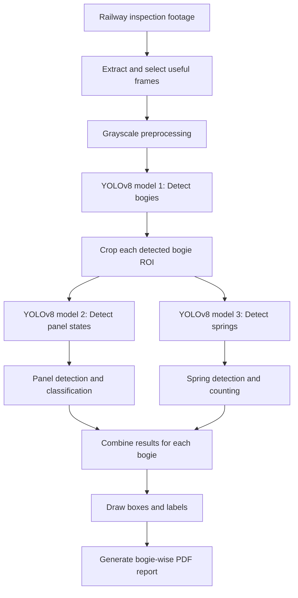

# Automated Cargo Train Bogie Inspection Using YOLOv8

## Problem Statement

At **Bhusawal Railway Station**, a manual cargo-train inspection takes approximately **15 hours**, according to the project brief. Checking each wagon's mechanical components manually is time-consuming, repetitive, and vulnerable to missed defects, particularly when many wagons must be inspected.

**Objective:** Build an AI-assisted computer-vision inspection system to reduce the time and manual effort required to inspect cargo train bogies, identify their door/access panels and suspension springs, and prepare an inspection report.

> The **15 hours** is the reported manual inspection baseline, **not** a measured automated inspection time. A full-train before/after timing study has not yet been documented.

## Project Overview

This project uses a **hierarchical, three-model YOLOv8 detection pipeline**: detect a bogie first, crop that region, inspect its door/access panels and suspension springs, then generate an annotated **PDF inspection report**. The prototype has a **Streamlit** interface for uploading images and reviewing detections.

**Inspection targets per bogie:** **2 door/access panels** and **6 suspension springs**. The system counts detected springs and identifies panel states. A discrepancy from the expected count may require manual review; a missed detection alone does not prove a missing physical component.

## From Railway Footage to an AI Model

The project was developed using footage collected through collaboration with railway personnel, including collaborators described by the project author as being from **South Railway Station**.

1. **Collected inspection footage.** Gathered cargo train videos from the railway personnel involved in the inspection work.
2. **Extracted frames.** Converted the footage into individual images for training and testing.
3. **Selected useful frames.** Retained clear side views where bogies, panels, and springs were visible; excluded unsuitable blurred and obstructed frames.
4. **Annotated in Roboflow.** Manually labeled bogies, panel states, and individual suspension springs using bounding boxes.
5. **Prepared the datasets.** Exported labeled datasets in YOLO-compatible format and applied preprocessing.
6. **Trained YOLOv8 models.** Developed three specialized detectors: one for bogies, one for panel states, and one for springs.
7. **Tested inference.** Ran inference on images and explored video inference during development.
8. **Built the inspection UI.** Integrated the models into Streamlit to display annotated images, count detected springs, and generate reports.

### Dataset

The accompanying research paper describes the following custom annotated datasets:

| Dataset | Images | Purpose |
| --- | ---: | --- |
| Bogie detection | 69 | Find each bogie and create a region of interest |
| Panel-state detection | 99 | Classify access panels as open, closed, or partially open |
| Spring detection | 211 | Locate and count individual suspension springs |

Images were prepared at **640 × 640** resolution. To suppress irrelevant color differences due to rust, paint, and dirt, images were processed using grayscale luminance conversion, then made compatible with the three-channel pretrained YOLO input.

The grayscale conversion is:

`Y = 0.299R + 0.587G + 0.114B`

## System Architecture

Instead of detecting tiny components in the entire image, the system **locates the bogie first**, then limits the panel and spring detectors to that cropped region. This reduces background distractions and helps make the workflow modular.



### Stage 1 — Bogie localization

The first **YOLOv8** model detects the bogie in the uploaded image and returns its bounding box. The system crops the corresponding region so smaller parts can be inspected without the full track or train background.

### Stage 2 — Door/access panel inspection

The second model looks for panels inside that bogie and classifies their operational state:

- `Panel_Open` — open panel
- `Panel_Closed` — closed panel
- `Panel_Partial` — partially open panel
  

The project specification expects **two access panels per bogie**. The current Streamlit code records a panel-status label for each bogie; detailed per-panel discrepancy alerts can be added in the next iteration.


### Stage 3 — Suspension spring inspection

The third model detects individual instances of `Spring_Present` and calculates their total count for the detected bogie. The project specification expects **six springs per bogie**.

For example, if only five springs are detected where six are expected, the count should be **flagged for human inspection**. The currently committed app reports the count, but does not yet automatically implement that six-versus-detected alert.

### Stage 4 — Annotated output and PDF generation

Detected boxes are projected back onto the full image. The Streamlit interface shows the annotated image and lets the operator generate a **ReportLab PDF** with one section per detected bogie, showing its panel status, spring count, and annotated crop.

**[See a sample generated inspection PDF](bogie_report%20%283%29.pdf)**

## Detection Output

This screenshot is already available in the existing repository and shows the Streamlit detection results:

<p align="center">
  
</p>

## Project Image Gallery — Images to Be Added

The following slots are reserved for the actual screenshots and labeled frames. Once the files are placed in an `assets/` folder, replace the descriptions with the matching image references.

| Image slot | Screenshot to add | Suggested repository file |
| --- | --- | --- |
| 1. Input cargo train frame | Selected frame from the collected footage | `assets/input-frame.png` |
| 2. Bogie labeling | Roboflow bounding boxes for bogie detection | `assets/bogie-annotation.png` |
| 3. Panel labeling | Roboflow open/closed/partial panel annotations | `assets/panel-annotation.png` |
| 4. Spring labeling | Roboflow spring bounding boxes | `assets/spring-annotation.png` |
| 5. Model inference | Detection output showing the components | `assets/inference-output.png` |
| 6. Streamlit screen | Full application screenshot | `assets/streamlit-interface.png` |
| 7. PDF report | Screenshot from a generated inspection report | `assets/report-preview.png` |

<!-- Once images are uploaded, display them using syntax like:


-->


## Model Evaluation

The version-controlled comparison notebook records the following metrics from a **panel-detection validation run using 12 images**, on an **Apple M4 CPU**. These results should not be represented as the measured accuracy of the complete three-model, whole-train system.

| Model | Precision | Recall | mAP@50 | mAP@50–95 | Inference per image |
| --- | ---: | ---: | ---: | ---: | ---: |
| **YOLOv8** | **0.9959** | **1.0000** | **0.9950** | 0.9568 | **23.7 ms** |
| YOLOv9c | 1.0000 | 1.0000 | 0.9950 | 0.9810 | 167.0 ms |
| YOLOv11 | 0.0000 | 0.0000 | 0.0000 | 0.0000 | 17.3 ms* |

*YOLOv11 produced no valid detections in the recorded validation run. Its lower latency does not imply a usable result. These results are limited by the small sample size.*

YOLOv8 was chosen for the prototype because it provided an effective **speed/accuracy balance** on the recorded experiment. Its **23.7 ms** measurement is the inference latency of the tested model on individual validation images, **not** the time needed to inspect an entire train.

- [Validation and model comparison notebook](model_comparison/validation.ipynb)
- [Model comparison image](model_comparison/comparison_output.png)

## Technology Stack

| Function | Tools |
| --- | --- |
| Computer vision | Python, OpenCV, NumPy |
| Detection | Ultralytics YOLOv8 |
| Annotation | Roboflow |
| Web application | Streamlit |
| PDF reporting | ReportLab |
| Evaluation | Jupyter Notebook; YOLOv8, YOLOv9c, and YOLOv11 comparison |

## Run the Streamlit Application

### 1. Clone the repository

```bash
git clone https://github.com/arjav-0412/Automated-Railway-Inspection.git
cd Automated-Railway-Inspection
```

### 2. Install dependencies

```bash
python -m venv .venv
source .venv/bin/activate
pip install streamlit ultralytics opencv-python numpy reportlab
```

For Windows, activate the environment using `.venv\Scripts\activate`.

### 3. Fix local model paths before starting

**Important:** The repository's `streamlit_UI/app.py` currently loads models with absolute file paths from the original developer's Mac. Replace its three hard-coded `YOLO(...)` model paths with these portable paths:

```python
from pathlib import Path

MODEL_DIR = Path(__file__).resolve().parent
bogie_model = YOLO(str(MODEL_DIR / "best (5).pt"))
panel_model = YOLO(str(MODEL_DIR / "best.pt"))
spring_model = YOLO(str(MODEL_DIR / "best (1).pt"))
```

The model weight files are already located in `streamlit_UI/`. **This README documentation does not modify the application code.**

### 4. Run Streamlit

```bash
streamlit run streamlit_UI/app.py
```

Upload an image in **JPG/JPEG/PNG** format. Inspect the drawn bounding boxes and labels. Click **Generate Report** to create and download a PDF.

## Repository Structure

```text
Automated-Railway-Inspection/
├── README.md
├── streamlit_UI/
│   ├── app.py                   # Streamlit inference and PDF-reporting interface
│   ├── best (5).pt              # Bogie detector
│   ├── best.pt                  # Panel-state detector
│   ├── best (1).pt              # Spring detector
│   └── greyscale_output_pil.jpg
├── dataset/
│   ├── Boggie_Detect_Correct.zip
│   ├── PanelDetect.v3i.yolov8.zip
│   ├── Spring_correct.zip
│   └── x.ipynb
├── model_comparison/
│   ├── validation.ipynb
│   └── comparison_output.png
├── bogie_report (3).pdf         # Example generated report
└── PROJECT II-ARJAVPATIL .pptx
```

## Current Limitations and Future Improvements

This is a working **research prototype**, not a certified railway safety system. The datasets were collected in a limited recording environment, and broader real-world validation is needed.

Future improvements include continuous video processing, frame-to-frame bogie tracking and deduplication, automated alerts for missing expected components, confidence-aware inspection recommendations, and a full-train timing study to compare automated inspection against the reported **15-hour** manual baseline.

## Research and Acknowledgements

The accompanying paper, **“Automated Cargo Train Bogie Inspection Using a Hierarchical Multi-Stage Object Detection Pipeline,”** describes the dataset, model architecture, comparisons, and limitations in more detail. A public link can be added here when the paper is uploaded or published.

Acknowledgement to the railway personnel who collaborated by providing video footage and inspection context.

---


